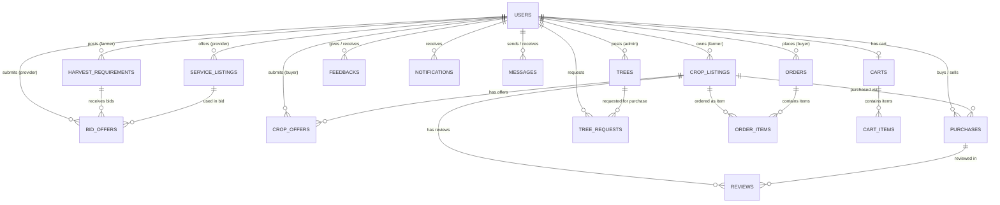

# KrishiConnect - Relational Database Design (MySQL 8)

## 1. Overview & Migration Philosophy

The original MongoDB database utilized 16 unstructured collections with embedded documents, manual ObjectId references, and duplicate concepts (such as `Purchase` vs `Order` vs `PurchaseRequest`). In this migration to MySQL 8:
- Every entity has a strictly typed relational schema with primary keys (`BIGINT AUTO_INCREMENT`).
- Proper foreign key constraints (`ON DELETE CASCADE` or `RESTRICT`) enforce referential integrity.
- Precise financial types (`DECIMAL(10,2)`) replace floating point numbers for currency, prices, and totals.
- Proper indexes are defined for searching, filtering, and foreign key joins.
- Standardized `created_at` and `updated_at` timestamps are maintained across all tables.

---

## 2. Entity-Relationship Model (Relational Schema)



---

## 3. Detailed Table Specifications

### 3.1 `users`
Replaces Mongoose `User` collection.
```sql
CREATE TABLE users (
    id BIGINT AUTO_INCREMENT PRIMARY KEY,
    name VARCHAR(100) NOT NULL,
    email VARCHAR(150) NOT NULL UNIQUE,
    password VARCHAR(255) NOT NULL,
    phone VARCHAR(15) UNIQUE,
    role VARCHAR(20) NOT NULL, -- 'farmer', 'provider', 'buyer', 'admin'
    is_blocked BOOLEAN NOT NULL DEFAULT FALSE,
    is_verified BOOLEAN NOT NULL DEFAULT FALSE,
    location VARCHAR(255),
    business_name VARCHAR(150),
    service_type VARCHAR(50), -- 'vehicles', 'labour', 'both'
    vehicle_count INT DEFAULT 0,
    bio TEXT,
    avatar VARCHAR(500),
    average_rating DECIMAL(3,2) DEFAULT 0.00,
    total_ratings INT DEFAULT 0,
    last_login TIMESTAMP NULL,
    created_at TIMESTAMP DEFAULT CURRENT_TIMESTAMP,
    updated_at TIMESTAMP DEFAULT CURRENT_TIMESTAMP ON UPDATE CURRENT_TIMESTAMP,
    INDEX idx_user_role_blocked (role, is_blocked)
) ENGINE=InnoDB DEFAULT CHARSET=utf8mb4;
```

### 3.2 `crop_listings`
Replaces Mongoose `CropListing` collection.
```sql
CREATE TABLE crop_listings (
    id BIGINT AUTO_INCREMENT PRIMARY KEY,
    farmer_id BIGINT NOT NULL,
    crop_name VARCHAR(150) NOT NULL,
    category VARCHAR(50) NOT NULL DEFAULT 'Other',
    quantity_amount DECIMAL(10,2) NOT NULL,
    quantity_unit VARCHAR(20) NOT NULL DEFAULT 'Quintal',
    price_amount DECIMAL(10,2) NOT NULL,
    price_unit VARCHAR(50) NOT NULL DEFAULT 'per Quintal',
    price_negotiable BOOLEAN NOT NULL DEFAULT TRUE,
    image VARCHAR(500),
    address VARCHAR(255) NOT NULL,
    district VARCHAR(100),
    state VARCHAR(100),
    pincode VARCHAR(20),
    harvest_date DATE,
    harvest_season VARCHAR(30),
    harvest_grade VARCHAR(20) DEFAULT 'A',
    contact_phone VARCHAR(20),
    description TEXT,
    status VARCHAR(20) NOT NULL DEFAULT 'active', -- 'active', 'sold', 'expired', 'withdrawn'
    views INT NOT NULL DEFAULT 0,
    offer_count INT NOT NULL DEFAULT 0,
    expires_at TIMESTAMP NULL,
    created_at TIMESTAMP DEFAULT CURRENT_TIMESTAMP,
    updated_at TIMESTAMP DEFAULT CURRENT_TIMESTAMP ON UPDATE CURRENT_TIMESTAMP,
    CONSTRAINT fk_crop_farmer FOREIGN KEY (farmer_id) REFERENCES users(id) ON DELETE CASCADE,
    INDEX idx_crop_status_created (status, created_at),
    INDEX idx_crop_name (crop_name),
    INDEX idx_crop_location (state, district)
) ENGINE=InnoDB DEFAULT CHARSET=utf8mb4;
```

### 3.3 `harvest_requirements`
Replaces Mongoose `HarvestRequirement` collection.
```sql
CREATE TABLE harvest_requirements (
    id BIGINT AUTO_INCREMENT PRIMARY KEY,
    farmer_id BIGINT NOT NULL,
    vehicle_type VARCHAR(50) NOT NULL,
    manpower INT NOT NULL DEFAULT 0,
    crop_type VARCHAR(100) NOT NULL,
    quantity_amount DECIMAL(10,2) NOT NULL,
    quantity_unit VARCHAR(20) NOT NULL DEFAULT 'Quintal',
    duration_value INT NOT NULL DEFAULT 1,
    duration_unit VARCHAR(20) NOT NULL DEFAULT 'Days',
    address VARCHAR(255) NOT NULL,
    district VARCHAR(100),
    state VARCHAR(100),
    pincode VARCHAR(20),
    urgency VARCHAR(20) NOT NULL DEFAULT 'normal', -- 'normal', 'urgent', 'immediate'
    notes TEXT,
    status VARCHAR(20) NOT NULL DEFAULT 'open', -- 'open', 'in-progress', 'completed', 'cancelled'
    accepted_bid_id BIGINT NULL,
    created_at TIMESTAMP DEFAULT CURRENT_TIMESTAMP,
    updated_at TIMESTAMP DEFAULT CURRENT_TIMESTAMP ON UPDATE CURRENT_TIMESTAMP,
    CONSTRAINT fk_req_farmer FOREIGN KEY (farmer_id) REFERENCES users(id) ON DELETE CASCADE,
    INDEX idx_req_status (status, created_at),
    INDEX idx_req_crop_state (crop_type, state)
) ENGINE=InnoDB DEFAULT CHARSET=utf8mb4;
```

### 3.4 `service_listings`
Replaces Mongoose `ServiceListing` collection.
```sql
CREATE TABLE service_listings (
    id BIGINT AUTO_INCREMENT PRIMARY KEY,
    provider_id BIGINT NOT NULL,
    vehicle_type VARCHAR(50),
    vehicle_count INT DEFAULT 1,
    vehicle_capacity VARCHAR(50),
    vehicle_registration_no VARCHAR(50),
    vehicle_description TEXT,
    manpower_available INT DEFAULT 0,
    manpower_skills TEXT,
    manpower_description TEXT,
    price_per_day DECIMAL(10,2) NOT NULL,
    is_available BOOLEAN NOT NULL DEFAULT TRUE,
    available_from DATE,
    available_to DATE,
    availability_notes TEXT,
    service_states TEXT,
    service_districts TEXT,
    service_radius INT DEFAULT 50,
    service_type VARCHAR(50) NOT NULL, -- 'transport', 'manpower', 'harvester', 'cold-storage', 'both'
    rating DECIMAL(3,2) DEFAULT 0.00,
    review_count INT DEFAULT 0,
    is_active BOOLEAN NOT NULL DEFAULT TRUE,
    created_at TIMESTAMP DEFAULT CURRENT_TIMESTAMP,
    updated_at TIMESTAMP DEFAULT CURRENT_TIMESTAMP ON UPDATE CURRENT_TIMESTAMP,
    CONSTRAINT fk_service_provider FOREIGN KEY (provider_id) REFERENCES users(id) ON DELETE CASCADE,
    INDEX idx_service_active (is_active, is_available)
) ENGINE=InnoDB DEFAULT CHARSET=utf8mb4;
```

### 3.5 `bid_offers`
Replaces Mongoose `BidOffer` collection.
```sql
CREATE TABLE bid_offers (
    id BIGINT AUTO_INCREMENT PRIMARY KEY,
    provider_id BIGINT NOT NULL,
    farmer_id BIGINT NOT NULL,
    requirement_id BIGINT NOT NULL,
    service_id BIGINT NULL,
    price DECIMAL(10,2) NOT NULL,
    price_type VARCHAR(30) NOT NULL DEFAULT 'per-day', -- 'per-day', 'fixed', 'per-quintal'
    message VARCHAR(500),
    status VARCHAR(20) NOT NULL DEFAULT 'pending', -- 'pending', 'accepted', 'rejected', 'withdrawn', 'completed'
    responded_at TIMESTAMP NULL,
    created_at TIMESTAMP DEFAULT CURRENT_TIMESTAMP,
    updated_at TIMESTAMP DEFAULT CURRENT_TIMESTAMP ON UPDATE CURRENT_TIMESTAMP,
    CONSTRAINT fk_bid_provider FOREIGN KEY (provider_id) REFERENCES users(id) ON DELETE CASCADE,
    CONSTRAINT fk_bid_farmer FOREIGN KEY (farmer_id) REFERENCES users(id) ON DELETE CASCADE,
    CONSTRAINT fk_bid_requirement FOREIGN KEY (requirement_id) REFERENCES harvest_requirements(id) ON DELETE CASCADE,
    CONSTRAINT fk_bid_service FOREIGN KEY (service_id) REFERENCES service_listings(id) ON DELETE SET NULL,
    UNIQUE KEY uk_provider_requirement (provider_id, requirement_id),
    INDEX idx_bid_status (status, created_at)
) ENGINE=InnoDB DEFAULT CHARSET=utf8mb4;
```

### 3.6 `crop_offers`
Replaces Mongoose `CropOffer` collection.
```sql
CREATE TABLE crop_offers (
    id BIGINT AUTO_INCREMENT PRIMARY KEY,
    buyer_id BIGINT NOT NULL,
    farmer_id BIGINT NOT NULL,
    listing_id BIGINT NOT NULL,
    offer_price DECIMAL(10,2) NOT NULL,
    quantity_amount DECIMAL(10,2) NOT NULL,
    quantity_unit VARCHAR(20) NOT NULL DEFAULT 'Quintal',
    message VARCHAR(500),
    status VARCHAR(20) NOT NULL DEFAULT 'pending', -- 'pending', 'accepted', 'rejected', 'counter', 'withdrawn', 'completed'
    counter_price DECIMAL(10,2) NULL,
    counter_message VARCHAR(500) NULL,
    responded_at TIMESTAMP NULL,
    expires_at TIMESTAMP NULL,
    created_at TIMESTAMP DEFAULT CURRENT_TIMESTAMP,
    updated_at TIMESTAMP DEFAULT CURRENT_TIMESTAMP ON UPDATE CURRENT_TIMESTAMP,
    CONSTRAINT fk_offer_buyer FOREIGN KEY (buyer_id) REFERENCES users(id) ON DELETE CASCADE,
    CONSTRAINT fk_offer_farmer FOREIGN KEY (farmer_id) REFERENCES users(id) ON DELETE CASCADE,
    CONSTRAINT fk_offer_listing FOREIGN KEY (listing_id) REFERENCES crop_listings(id) ON DELETE CASCADE,
    INDEX idx_offer_status (status, created_at)
) ENGINE=InnoDB DEFAULT CHARSET=utf8mb4;
```

### 3.7 `purchases`
Replaces Mongoose `Purchase` collection.
```sql
CREATE TABLE purchases (
    id BIGINT AUTO_INCREMENT PRIMARY KEY,
    buyer_id BIGINT NOT NULL,
    farmer_id BIGINT NOT NULL,
    listing_id BIGINT NOT NULL,
    offer_id BIGINT NULL,
    quantity_amount DECIMAL(10,2) NOT NULL,
    quantity_unit VARCHAR(20) NOT NULL DEFAULT 'Quintal',
    agreed_price DECIMAL(10,2) NOT NULL,
    total_amount DECIMAL(10,2) NOT NULL,
    receipt_file_name VARCHAR(255),
    receipt_file_path VARCHAR(500),
    receipt_uploaded_at TIMESTAMP NULL,
    payment_status VARCHAR(30) NOT NULL DEFAULT 'pending', -- 'pending', 'receipt-uploaded', 'verified', 'disputed', 'completed', 'refunded'
    payment_method VARCHAR(30), -- 'UPI', 'NEFT', 'RTGS', 'Cheque', 'Cash', 'RAZORPAY', 'Other'
    transaction_id VARCHAR(100),
    notes TEXT,
    dispute_reason TEXT,
    completed_at TIMESTAMP NULL,
    created_at TIMESTAMP DEFAULT CURRENT_TIMESTAMP,
    updated_at TIMESTAMP DEFAULT CURRENT_TIMESTAMP ON UPDATE CURRENT_TIMESTAMP,
    CONSTRAINT fk_purchase_buyer FOREIGN KEY (buyer_id) REFERENCES users(id) ON DELETE CASCADE,
    CONSTRAINT fk_purchase_farmer FOREIGN KEY (farmer_id) REFERENCES users(id) ON DELETE CASCADE,
    CONSTRAINT fk_purchase_listing FOREIGN KEY (listing_id) REFERENCES crop_listings(id) ON DELETE CASCADE,
    CONSTRAINT fk_purchase_offer FOREIGN KEY (offer_id) REFERENCES crop_offers(id) ON DELETE SET NULL,
    INDEX idx_purchase_payment_status (payment_status, created_at)
) ENGINE=InnoDB DEFAULT CHARSET=utf8mb4;
```

### 3.8 `reviews`
Replaces Mongoose `Review` collection.
```sql
CREATE TABLE reviews (
    id BIGINT AUTO_INCREMENT PRIMARY KEY,
    crop_id BIGINT NOT NULL,
    purchase_id BIGINT NOT NULL,
    user_id BIGINT NOT NULL,
    rating INT NOT NULL,
    comment TEXT NOT NULL,
    created_at TIMESTAMP DEFAULT CURRENT_TIMESTAMP,
    updated_at TIMESTAMP DEFAULT CURRENT_TIMESTAMP ON UPDATE CURRENT_TIMESTAMP,
    CONSTRAINT fk_review_crop FOREIGN KEY (crop_id) REFERENCES crop_listings(id) ON DELETE CASCADE,
    CONSTRAINT fk_review_purchase FOREIGN KEY (purchase_id) REFERENCES purchases(id) ON DELETE CASCADE,
    CONSTRAINT fk_review_user FOREIGN KEY (user_id) REFERENCES users(id) ON DELETE CASCADE,
    UNIQUE KEY uk_purchase_review (purchase_id, user_id)
) ENGINE=InnoDB DEFAULT CHARSET=utf8mb4;
```

### 3.9 `feedbacks`
Replaces Mongoose `Feedback` collection.
```sql
CREATE TABLE feedbacks (
    id BIGINT AUTO_INCREMENT PRIMARY KEY,
    from_user_id BIGINT NOT NULL,
    to_user_id BIGINT NOT NULL,
    reference_type VARCHAR(30), -- 'purchase', 'bid', 'service'
    reference_id BIGINT NULL,
    rating INT NOT NULL,
    comment TEXT,
    tags VARCHAR(255),
    is_public BOOLEAN NOT NULL DEFAULT TRUE,
    created_at TIMESTAMP DEFAULT CURRENT_TIMESTAMP,
    updated_at TIMESTAMP DEFAULT CURRENT_TIMESTAMP ON UPDATE CURRENT_TIMESTAMP,
    CONSTRAINT fk_feedback_from FOREIGN KEY (from_user_id) REFERENCES users(id) ON DELETE CASCADE,
    CONSTRAINT fk_feedback_to FOREIGN KEY (to_user_id) REFERENCES users(id) ON DELETE CASCADE,
    INDEX idx_feedback_to (to_user_id, created_at)
) ENGINE=InnoDB DEFAULT CHARSET=utf8mb4;
```

### 3.10 `notifications`
Replaces Mongoose `Notification` collection.
```sql
CREATE TABLE notifications (
    id BIGINT AUTO_INCREMENT PRIMARY KEY,
    user_id BIGINT NOT NULL,
    title VARCHAR(150) NOT NULL,
    message TEXT NOT NULL,
    is_read BOOLEAN NOT NULL DEFAULT FALSE,
    created_at TIMESTAMP DEFAULT CURRENT_TIMESTAMP,
    updated_at TIMESTAMP DEFAULT CURRENT_TIMESTAMP ON UPDATE CURRENT_TIMESTAMP,
    CONSTRAINT fk_notif_user FOREIGN KEY (user_id) REFERENCES users(id) ON DELETE CASCADE,
    INDEX idx_notif_user_unread (user_id, is_read, created_at)
) ENGINE=InnoDB DEFAULT CHARSET=utf8mb4;
```

### 3.11 `messages`
Replaces Mongoose `Message` collection.
```sql
CREATE TABLE messages (
    id BIGINT AUTO_INCREMENT PRIMARY KEY,
    sender_id BIGINT NOT NULL,
    receiver_id BIGINT NOT NULL,
    sender_role VARCHAR(20) NOT NULL,
    crop_id BIGINT NULL,
    message TEXT NOT NULL,
    created_at TIMESTAMP DEFAULT CURRENT_TIMESTAMP,
    CONSTRAINT fk_msg_sender FOREIGN KEY (sender_id) REFERENCES users(id) ON DELETE CASCADE,
    CONSTRAINT fk_msg_receiver FOREIGN KEY (receiver_id) REFERENCES users(id) ON DELETE CASCADE,
    CONSTRAINT fk_msg_crop FOREIGN KEY (crop_id) REFERENCES crop_listings(id) ON DELETE SET NULL,
    INDEX idx_msg_conv (sender_id, receiver_id, crop_id)
) ENGINE=InnoDB DEFAULT CHARSET=utf8mb4;
```

### 3.12 `trees` & `tree_requests`
Replaces Mongoose `Tree` and `TreeRequest` collections.
```sql
CREATE TABLE trees (
    id BIGINT AUTO_INCREMENT PRIMARY KEY,
    name VARCHAR(150) NOT NULL,
    scientific_name VARCHAR(150),
    description TEXT NOT NULL,
    category VARCHAR(50) NOT NULL DEFAULT 'Other',
    mrp DECIMAL(10,2) NOT NULL DEFAULT 0.00,
    benefits TEXT,
    plantation_guide TEXT,
    image VARCHAR(500),
    posted_by BIGINT NOT NULL,
    created_at TIMESTAMP DEFAULT CURRENT_TIMESTAMP,
    updated_at TIMESTAMP DEFAULT CURRENT_TIMESTAMP ON UPDATE CURRENT_TIMESTAMP,
    CONSTRAINT fk_tree_posted_by FOREIGN KEY (posted_by) REFERENCES users(id) ON DELETE CASCADE
) ENGINE=InnoDB DEFAULT CHARSET=utf8mb4;

CREATE TABLE tree_requests (
    id BIGINT AUTO_INCREMENT PRIMARY KEY,
    tree_id BIGINT NOT NULL,
    user_id BIGINT NOT NULL,
    quantity INT NOT NULL DEFAULT 1,
    total_price DECIMAL(10,2) NOT NULL,
    full_name VARCHAR(100) NOT NULL,
    phone VARCHAR(20) NOT NULL,
    shipping_address TEXT NOT NULL,
    status VARCHAR(30) NOT NULL DEFAULT 'Pending', -- 'Pending', 'Approved', 'Shipped', 'Delivered', 'Cancelled'
    payment_status VARCHAR(30) NOT NULL DEFAULT 'Pending', -- 'Pending', 'Completed', 'Failed'
    created_at TIMESTAMP DEFAULT CURRENT_TIMESTAMP,
    updated_at TIMESTAMP DEFAULT CURRENT_TIMESTAMP ON UPDATE CURRENT_TIMESTAMP,
    CONSTRAINT fk_treereq_tree FOREIGN KEY (tree_id) REFERENCES trees(id) ON DELETE CASCADE,
    CONSTRAINT fk_treereq_user FOREIGN KEY (user_id) REFERENCES users(id) ON DELETE CASCADE,
    INDEX idx_treereq_user (user_id, status)
) ENGINE=InnoDB DEFAULT CHARSET=utf8mb4;
```

### 3.13 `orders`, `order_items`, `carts`, `cart_items`
Replaces Mongoose `Order` and `Cart` collections, properly resolving the missing `Product` relationship to `crop_listings`.
```sql
CREATE TABLE orders (
    id BIGINT AUTO_INCREMENT PRIMARY KEY,
    buyer_id BIGINT NOT NULL,
    farmer_id BIGINT NOT NULL,
    total_amount DECIMAL(10,2) NOT NULL,
    shipping_address TEXT NOT NULL,
    payment_method VARCHAR(30) NOT NULL DEFAULT 'COD', -- 'COD', 'UPI', 'RAZORPAY'
    payment_status VARCHAR(30) NOT NULL DEFAULT 'Pending', -- 'Pending', 'Paid', 'Failed'
    order_status VARCHAR(30) NOT NULL DEFAULT 'Placed', -- 'Placed', 'Accepted', 'Packed', 'Shipped', 'Delivered', 'Cancelled'
    created_at TIMESTAMP DEFAULT CURRENT_TIMESTAMP,
    updated_at TIMESTAMP DEFAULT CURRENT_TIMESTAMP ON UPDATE CURRENT_TIMESTAMP,
    CONSTRAINT fk_order_buyer FOREIGN KEY (buyer_id) REFERENCES users(id) ON DELETE CASCADE,
    CONSTRAINT fk_order_farmer FOREIGN KEY (farmer_id) REFERENCES users(id) ON DELETE CASCADE
) ENGINE=InnoDB DEFAULT CHARSET=utf8mb4;

CREATE TABLE order_items (
    id BIGINT AUTO_INCREMENT PRIMARY KEY,
    order_id BIGINT NOT NULL,
    crop_listing_id BIGINT NOT NULL,
    quantity DECIMAL(10,2) NOT NULL DEFAULT 1.00,
    price DECIMAL(10,2) NOT NULL,
    CONSTRAINT fk_item_order FOREIGN KEY (order_id) REFERENCES orders(id) ON DELETE CASCADE,
    CONSTRAINT fk_item_crop FOREIGN KEY (crop_listing_id) REFERENCES crop_listings(id) ON DELETE CASCADE
) ENGINE=InnoDB DEFAULT CHARSET=utf8mb4;

CREATE TABLE carts (
    id BIGINT AUTO_INCREMENT PRIMARY KEY,
    user_id BIGINT NOT NULL UNIQUE,
    created_at TIMESTAMP DEFAULT CURRENT_TIMESTAMP,
    updated_at TIMESTAMP DEFAULT CURRENT_TIMESTAMP ON UPDATE CURRENT_TIMESTAMP,
    CONSTRAINT fk_cart_user FOREIGN KEY (user_id) REFERENCES users(id) ON DELETE CASCADE
) ENGINE=InnoDB DEFAULT CHARSET=utf8mb4;

CREATE TABLE cart_items (
    id BIGINT AUTO_INCREMENT PRIMARY KEY,
    cart_id BIGINT NOT NULL,
    crop_listing_id BIGINT NOT NULL,
    quantity DECIMAL(10,2) NOT NULL DEFAULT 1.00,
    CONSTRAINT fk_cart_item_cart FOREIGN KEY (cart_id) REFERENCES carts(id) ON DELETE CASCADE,
    CONSTRAINT fk_cart_item_crop FOREIGN KEY (crop_listing_id) REFERENCES crop_listings(id) ON DELETE CASCADE,
    UNIQUE KEY uk_cart_crop (cart_id, crop_listing_id)
) ENGINE=InnoDB DEFAULT CHARSET=utf8mb4;
```
